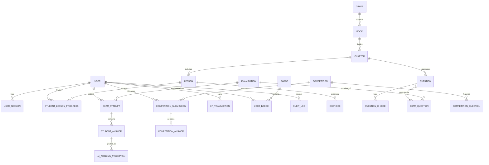
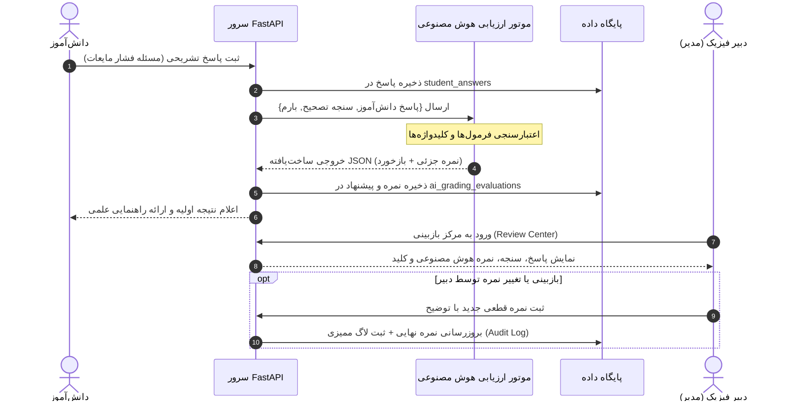

# سند جامع معماری فنی سامانه (Technical Architecture Specification)
## انجمن علمی فیزیک دبیرستان استعدادهای درخشان شهید بهشتی ۲

این سند تشریح‌کننده معماری نرم‌افزار، ساختار پایگاه‌داده، مدل‌های امنیتی، خط‌لوله تصحیح هوش مصنوعی و چرخه حیات داده در پلتفرم آموزشی فیزیک شهید بهشتی ۲ می‌باشد.

---

## ۱. فلسفه طراحی و توجیه انتخاب پشته تکنولوژی (Stack Justification)

سامانه بر اساس اصول **سادگی پایدار (Sustainable Simplicity)**، **عملکرد بالا**، **امنیت چندلایه** و **عدم وابستگی به زیرساخت‌های گران‌قیمت یا فریم‌ورک‌های شکننده** طراحی شده است:

| لایه | تکنولوژی انتخابی | دلایل انتخاب و توجیه فنی |
| :--- | :--- | :--- |
| **Backend Framework** | **Python 3.12 + FastAPI** | عملکرد نزدیک به Go/NodeJS به لطف Starlette و Uvicorn، پشتیبانی کامل از اعتبارسنجی داده با Pydantic V2، مستندسازی خودکار OpenAPI/Swagger و سازگاری بومی با ابزارهای پردازش زبان طبیعی و هوش مصنوعی. |
| **Database & ORM** | **PostgreSQL 16 + SQLAlchemy 2.0** | تراکنش‌های ACID قابل اتکا، کلیدهای خارجی سخت‌گیرانه، ایندکس‌های کارآمد و قابلیت ارتقا بدون وقفه. در محیط تست و توسعه محلی، بدون تغییر در مدل‌ها از SQLite3 با فعال‌سازی قفل‌های ForeignKey Pragma استفاده می‌شود. |
| **Authentication** | **Argon2id + Stateless JWT** | استفاده از امن‌ترین الگوریتم هش رمزعبور مقاوم در برابر حملات ASIC/GPU (برنده مسابقه Password Hashing Competition) به همراه توکن‌های JWT بدون نیاز به ذخیره نشست‌های سرگردان. |
| **Frontend Architecture** | **Vanilla JS SPA + Tailwind CSS + Lucide + KaTeX** | عدم نیاز به ابزارهای پیچیده باندلر (Vite/Webpack) که بر روی سرورهای با دسترسی محدود مشکل ایجاد می‌کنند؛ سرعت بارگذاری آنی، نمایش روان فرمول‌های ریاضی و فیزیکی به زبان لاتین با KaTeX و راست‌چینی استاندارد (RTL). |
| **Reverse Proxy** | **Nginx 1.25 Alpine** | محافظت در برابر حملات Brute-Force از طریق Rate Limiting، فشرده‌سازی خودکار Gzip، مدیریت نشست‌های SSL Let's Encrypt و کش دارایی‌های ایستا. |

---

## ۲. دیاگرام ارتباط موجودیت‌های پایگاه داده (Database ERD)



---

## ۳. شناسنامه جداول و مدل داده (Data Model Catalog)

پایگاه داده شامل ۲۸ جدول اصلی در ۵ حوزه عملیاتی است:

### ۳.۱. کاربران و دسترسی‌ها (Users & Authentication)
- `users`: شناسه، نام کاربری، هش کلمه عبور (Argon2id)، نام و نام خانوادگی، نقش (`student` یا `admin`)، پایه تحصیلی، امتیاز کل (XP)، تعداد روز استمرار، وضعیت حساب و تاریخ عضویت.
- `user_sessions`: توکن‌های صادر شده، IP ورود، نوع مرورگر و زمان انقضا.
- `audit_logs`: ثبت تغییرات کلیدی توسط مدیران (تغییر نمره، انتشار آزمون، تغییر کانفیگ AI) به همراه Snapshot مقادیر قبل و بعد.

### ۳.۲. ساختار آموزشی و سرفصل کتب (Curriculum)
- `grades`: پایه‌های هفتم، هشتم و نهم دبیرستان.
- `books`: کتب درسی رسمی وزارتخانه و کتب تکمیلی استعدادهای درخشان سمپاد.
- `chapters`: فصول دوازده‌گانه فیزیک به همراه اهداف آموزشی، پیش‌نیازها و صفحات مرجع.
- `lessons`: گام‌های یادگیری شامل متن تئوری، سناریوی آزمایش، بدفهمی علمی و جمع‌بندی.
- `exercises`: تمرین‌های تعاملی وسط درس با فیدبک آنی و پاداش XP.
- `student_lesson_progress`: رهگیری درصد تکمیل هر درس به ازای هر دانش‌آموز.
- `textbook_sources`: نگه‌داری متادیتای ۶ فایل PDF رسمی، وضعیت پردازش و حجم فایل‌ها.

### ۳.۳. بانک سوالات و آزمون‌ها (Question Bank & Exams)
- `questions`: ۳۶۰ سوال استاندارد تفکیک‌شده بر اساس فصل، پایه، نوع (`mcq` یا `written`)، سطح دشواری (`easy`, `medium`, `hard`)، متن سوال با فرمول‌های KaTeX، بارم و سنجه تصحیح (`grading_rubric`).
- `question_choices`: گزینه‌های سوالات چندگزینه‌ای با علامت‌گذاری گزینه صحیح و توضیح آموزشی.
- `examinations`: آزمون‌های زمان‌دار دوره‌ای با سقف نمره، مدت زمان و قوانین نمره منفی.
- `exam_questions`: ارتباط Many-to-Many میان آزمون و بانک سوالات همراه با بارم اختصاصی.
- `exam_attempts`: سوابق تلاش دانش‌آموزان، زمان شروع، زمان تحویل، نمره نهایی و وضعیت (`in_progress`, `submitted`, `graded`).
- `student_answers`: پاسخ ثبت‌شده دانش‌آموز برای هر سوال (گزینه انتخابی یا متن تشریحی) و نمره کسب‌شده.
- `ai_grading_evaluations`: جزئیات تحلیل هوش مصنوعی شامل نمره پیشنهادی، بازخورد آموزشی، خطاهای تشخیص‌داده‌شده و زمان پردازش.

### ۳.۴. مسابقات هفتگی (Weekly Competitions)
- `competitions`: عنوان مسابقه، مهلت شروع و پایان، وضعیت انتشار و راه‌حل نهایی.
- `competition_questions`: سوالات اختصاصی چالش هفتگی.
- `competition_submissions`: برگه‌های تحویل‌شده دانش‌آموزان به همراه رتبه و امتیاز نهایی.
- `competition_answers`: پاسخ‌های ارسالی برای سوالات مسابقه.

### ۳.۵. گیمیفیکیشن (Gamification & Engagement)
- `xp_transactions`: دفترکل تغییرات امتیاز تجربه دانش‌آموزان به صورت Idempotent (جلوگیری از اعطای مجدد امتیاز برای یک تمرین یا درس تکراری).
- `daily_streaks`: ثبت روزهای متوالی فعالیت بر اساس تقویم هجری شمسی (جلالی).
- `badges`: نشان‌های افتخار (مثلاً «کاوشگر چگالی»، «استاد الکتریسیته»، «استمرار ۷ روزه»).
- `user_badges`: نشان‌های کسب‌شده توسط هر دانش‌آموز به همراه زمان دستیابی.
- `levels`: جدول سطوح تحصیلی با حداقل XP موردنیاز.

---

## ۴. امنیت سیستم و کنترل دسترسی (Security Architecture)

1. **هشینگ رمزعبور (Argon2id):**
   - پارامترها: Time Cost = 2، Memory Cost = 19456 KiB، Parallelism = 1.
   - مقاومت حداکثری در برابر حملات Brute-Force و دیکشنری.

2. **احراز هویت بدون حالت (Stateless JWT):**
   - امضا شده با الگوریتم HMAC-SHA256 و کلید ۶۴ کاراکتری تصادفی.
   - تاریخ انقضای ۲۴ ساعته؛ بررسی لحظه‌ای مسدود نبودن حساب کاربری در دیتابیس در هر درخواست.

3. **تفکیک سطوح دسترسی (Server-Side RBAC):**
   - وابستگی `get_current_admin` روی تمامی مسیرهای `/api/admin/*` تضمین می‌کند که حتی در صورت دستکاری فرانت‌اند، هیچ درخواستی بدون نقش `admin` اجرا نخواهد شد.
   - دسترسی دانش‌آموزان به کلید سوالات و پاسخ‌نامه تا زمان اتمام آزمون یا انتشار رسمی مسدود است.

4. **محافظت در برابر تزریق کد و SSRF در پردازش PDF:**
   - متد `safe_download_pdf` دامنه‌های غیرمجاز، آدرس‌های محلی (`localhost`, `127.0.0.1`, `10.0.0.0/8`, `192.168.0.0/16`) و فایل‌های با سایز غیرمجاز (بیش از ۵۰ مگابایت) را مسدود می‌نماید.

---

## ۵. خط‌لوله تصحیح هوش مصنوعی (AI Grading Pipeline)

تصحیح پاسخ‌های تشریحی با رویکرد سنجه‌محور (Rubric-Based Evaluation) انجام می‌پذیرد:



### ساختار استاندارد خروجی هوش مصنوعی (Schema Enforcement)
پاسخ دریافتی از مدل هوش مصنوعی تحت اعتبارسنجی دقیق Pydantic قرار می‌گیرد:
```json
{
  "score": 1.75,
  "max_score": 2.0,
  "feedback": "فرمول فشار به درستی نوشته شده و تبدیل واحد انجام گرفته، اما در محاسبه عددی خطای جزئی رخ داده است.",
  "strengths": ["شناسایی فرمول P = rho * g * h", "تبدیل سانتی‌متر به متر"],
  "weaknesses": ["بی‌دقتی در ضرب اعشاری"],
  "missing_keywords": ["نیوتون بر متر مربع"],
  "confidence": 0.95
}
```

---

## ۶. عملکرد و بهینه‌سازی (Performance & Scaling)

- **ایندکس‌گذاری پایگاه داده:** تمامی ستون‌های جستجوی پرتکرار (`chapter_id`, `user_id`, `exam_id`, `created_at`) دارای شاخص‌های B-Tree هستند.
- **کش دارایی‌های ایستا:** کدهای CSS و تصاویر با هدرهای `Cache-Control: public, max-age=604800` توسط Nginx مستقیماً بدون درگیر کردن پایتون تحویل داده می‌شوند.
- **پردازش غیرهمگام (Async):** دانلود و اعتبارسنجی PDFهای حجیم در پس‌زمینه (Background Tasks) اجرا می‌شود تا هیچ درخواست کاربری معطل نماند.
